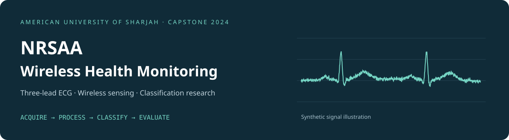
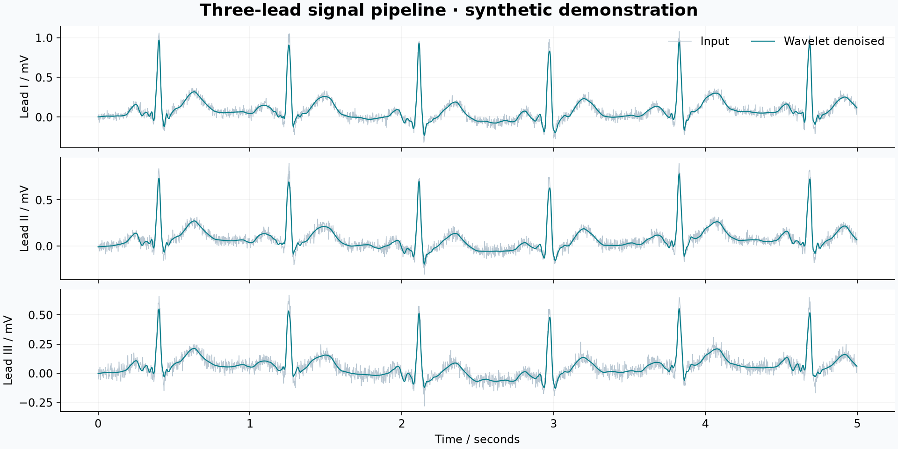
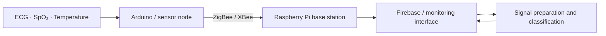

# NRSAA

**A working prototype for three-lead ECG processing, multilabel classification, and sensor acquisition.**

NRSAA gives you an end-to-end Python workflow: load ECG recordings, prepare signals, train a classifier, and inspect predictions. Run the included synthetic demo on your laptop without downloading patient data, connecting hardware, or supplying API keys. Then use your own recordings to explore different models and settings.

Developed from the **Real-Time Wireless Monitoring System with Predictive Analysis of Healthcare Data** capstone at the American University of Sharjah, 2023–2024.

[Quick start](#quick-start) · [Try a prediction](#try-a-prediction) · [Train on your data](#train-on-your-data) · [Research results](docs/research.md) · [Hardware](hardware/README.md)

## What you can run

| Component | Included functionality |
| --- | --- |
| Signal pipeline | Named leads I/II/III, calibration to mV, 500 Hz resampling, ten-second windows, sym5 wavelet denoising |
| Feature classifier | 53 signal/demographic features and a multilabel random forest |
| Neural classifier | Three-channel LSTM with nine independent label probabilities |
| Evaluation | Patient-group splits, per-label results, micro/macro metrics, saved predictions and models |
| Sensor capture | Bounded single-channel AD8232 serial capture and an Arduino example |
| Demo and tests | Generated recordings, visualizations, automated tests and CI |

The target labels are **NSR, AF, STach, SA, SB, PAC, SVPB, AFL, and SVT**. A recording can have multiple labels. See the [data contract](docs/data.md) for definitions, input requirements, and evaluation details.

## Quick start

Use **Python 3.11 or 3.12**. Clone the repository, or [download the source ZIP](https://github.com/niki-21/NRSAA/archive/refs/heads/main.zip) and extract it.

```sh
git clone https://github.com/niki-21/NRSAA.git
cd NRSAA
```

**macOS / Linux**

```sh
python3 -m venv .venv
source .venv/bin/activate
python -m pip install --upgrade pip
python -m pip install .
nrsaa demo --output outputs/demo
```

**Windows PowerShell** — activation is optional; run directly through the virtual environment:

```powershell
py -3.11 -m venv .venv
.\.venv\Scripts\python.exe -m pip install --upgrade pip
.\.venv\Scripts\python.exe -m pip install .
.\.venv\Scripts\nrsaa.exe demo --output outputs/demo
```

The first install downloads the Python dependencies. The demo itself runs locally with no external services. It creates **36 synthetic recordings**, prepares all three leads, trains a random forest, and evaluates held-out groups.

Open `outputs/demo/signals.png` to see the processed signals. Inspect `outputs/demo/run/metrics.json` for metrics and `split.json` for the train/test membership. Models and data stay in the ignored `outputs/` folder.



The waveforms and demo scores demonstrate software behavior, not diagnostic performance. Existing output directories are preserved; use a new name such as `outputs/demo-2` when rerunning.

## Try a prediction

After the demo, use its saved model on one of its generated recordings:

```sh
nrsaa predict outputs/demo/run/model.joblib outputs/demo/recordings/synthetic_000.hea
```

The command returns JSON with the recording ID, nine probabilities, and labels meeting the 0.5 threshold. On Windows, replace `nrsaa` with `.\.venv\Scripts\nrsaa.exe` in these examples.

## Train on your data

Supply paired PhysioNet-style `.hea`/`.mat` recordings and a JSON mapping from recording paths to patient groups. Obtain datasets separately under their applicable terms; patient data and pretrained clinical weights are not bundled.

```sh
nrsaa prepare data/raw outputs/features.npz --groups data/groups.json
nrsaa train outputs/features.npz --output outputs/baseline --trees 200 --seed 42
nrsaa predict outputs/baseline/model.joblib data/raw/example.hea
```

Preparation searches nested directories. Training separates patient groups and fits imputation on training records only. Each run saves the model, metrics, held-out probabilities, and split membership. [Input examples and artifact formats →](docs/data.md)

Without a patient mapping, an exploratory record-level split is available through `--allow-record-split`; its metrics do not establish patient-independent performance.

## Train the LSTM

The optional neural classifier preserves the temporal and lead dimensions:

```text
5000 time steps × 3 leads → LSTM(32) → Dropout(0.1)
                        → Dense(32) → Dense(16) → 9 sigmoid outputs
```

```sh
python -m pip install '.[neural]'
nrsaa prepare data/raw outputs/signals.npz --groups data/groups.json --include-signals
nrsaa train-lstm outputs/signals.npz --output outputs/lstm --epochs 50
nrsaa predict-lstm outputs/lstm data/raw/example.hea
```

To try this path immediately on the demo's synthetic recordings:

```sh
nrsaa prepare outputs/demo/recordings outputs/demo/signals.npz --groups outputs/demo/recordings/groups.json --include-signals
nrsaa train-lstm outputs/demo/signals.npz --output outputs/demo/lstm --epochs 1
nrsaa predict-lstm outputs/demo/lstm outputs/demo/recordings/synthetic_000.hea
```

The one-epoch example checks the workflow; it does not produce a useful diagnostic model. Neural training uses separate train/validation/test groups and restores the best validation-loss weights. Signals are held in memory, so start with a small dataset. TensorFlow support depends on your Python version and platform.

## Explore and extend

Install editable source and development tools to change the code:

```sh
python -m pip install -e '.[dev]'
python -m pytest
ruff check src tests scripts
```

Try changing `--trees` or `--seed`, comparing random-forest and LSTM outputs, or examining per-label support before interpreting aggregate scores. Signal preparation lives in `src/ecg_monitor/signal.py`, feature definitions in `features.py`, and the neural architecture in `neural.py`. Run `nrsaa --help` or `nrsaa train --help` for options.

## Capstone system and results

The wider capstone connects ECG, temperature and SpO₂ sensing to an Arduino/XBee node, Raspberry Pi base station, and monitoring application:



This repository provides the Python classification workflow and the single-channel acquisition example. The Flutter/Firebase application, integrated ZigBee firmware, and SE-ResNet are outside this release's executable scope.

The **2024 final report** records **92.01% accuracy, 93.14% recall, and 83.51% precision** for its feature-based neural model, plus **57 ms mean receiver-to-cloud transport latency** using Ethernet. These are historical capstone measurements, not performance claims for the included random forest or LSTM. [Methods, sources, and limitations →](docs/research.md)

## Project layout

```text
src/ecg_monitor/       signal processing, datasets, models, capture and CLI
hardware/             AD8232 sketch and acquisition guide
tests/                data validation, group isolation, model and serial tests
docs/                 data contract, research results and implementation notes
scripts/              documentation figure generation
third_party/          upstream license notices
.github/workflows/    automated tests and demo checks
```

## Team and license

**Nikita Miller · Samrin Saleem · Rhea Srivastava · Ahmed Sharafath Ahamed Zibli**

Advisors: **Dr. Salam Dhou** and **Dr. Ming Foey Teng**.

The Python code and documentation are available under the [MIT License](LICENSE): you can use, modify, and share them, including for your own experiments. Preserve the [third-party notices](third_party/README.md); the Arduino example retains its original SparkFun notice.

NRSAA is a working research prototype, not a clinically validated diagnostic device. Use trusted model files and keep patient data out of public repositories.
