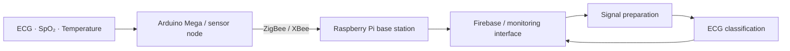

# NRSAA

**A senior design project connecting wireless vital-sign acquisition with ECG classification.** Built at the American University of Sharjah, 2023–2024.

The system combines ECG, pulse oximetry, and temperature sensors with an Arduino/XBee acquisition node, a Raspberry Pi base station, and a mobile monitoring interface. Its research component investigates nine cardiac rhythm labels using three ECG leads, wavelet denoising, and demographic information.

This repository contains the maintained Python signal pipeline, a recovered LSTM adaptation, an Arduino acquisition example, and a documented account of the wider system. The original Flutter/Firebase application, ZigBee integration firmware, and final SE-ResNet training implementation are not included in the recovered source.

[Run the demo](#quick-start) · [Research and results](docs/research.md) · [Data contract](docs/data.md) · [Hardware](hardware/README.md) · [Code provenance](docs/provenance.md)

## Project highlights

| Area | Outcome |
| --- | --- |
| ECG research | Three leads, nine labels, raw-signal and feature-based model experiments |
| Reported model results | **92.01% accuracy**, **93.14% recall**, **83.51% precision** for the feature + demographics model |
| Reported wireless testing | **57 ms mean / 92 ms maximum** with Ethernet at the receiver, across 1,000 packets |
| Maintained code | Installable package, synthetic demo, patient-group splitting, per-label evaluation, saved models and predictions |

The numeric project results above come from the **2024 final report**, pp. 91 and 105. They have not been reproduced by this codebase. The report's accuracy definition and averaging conventions have not been recovered; these figures should not be compared directly with the maintained baseline. [Read the methodology and limitations.](docs/research.md)

## System architecture



The diagram describes the capstone system. The executable Python workflow in this repository is:

```text
paired .hea / .mat recordings
    → select leads I, II, III and calibrate to mV
    → resample to 500 Hz · ten-second windows · sym5 denoising
    → 53 signal/demographic features OR [5000 × 3] waveforms
    → group-separated model training
    → probabilities · per-label metrics · saved split and model
```

## Quick start

Python 3.11 or newer. From this repository's root:

```sh
python -m venv .venv
source .venv/bin/activate
python -m pip install -e '.[dev]'
nrsaa demo --output outputs/demo
python -m pytest
```

On Windows, activate with `.venv\Scripts\activate`.

The demo generates 36 synthetic recordings, processes all three leads, trains a small multilabel random forest, and writes a signal plot, model, metrics, and held-out predictions. It uses no patient data and needs no hardware. Choose a new output directory when rerunning; existing runs are preserved.


*Generated waveforms demonstrate software behavior. They are not evidence of diagnostic performance.*

## Use your own recordings

Acquire the datasets separately. No patient data or model weights are distributed. See the [input format and grouping instructions](docs/data.md).

```sh
nrsaa prepare data/raw outputs/features.npz --groups data/groups.json
nrsaa train outputs/features.npz --output outputs/baseline
nrsaa predict outputs/baseline/model.joblib data/raw/example.hea
```

Training uses patient groups provided by you. Without a group mapping, training requires the explicit `--allow-record-split` flag and records the weaker evaluation design in its output. Imputation is fitted only on training data.

Each run saves `metrics.json`, `split.json`, `predictions.npz`, and `model.joblib`. Metrics distinguish exact-match accuracy, Hamming loss, micro/macro precision, recall, and F1; per-label counts expose performance on rare labels. Only load joblib models you trust.

## Recovered LSTM experiment

The earlier prototype's recurrent architecture is retained as an optional, modernized experiment:

```text
5000 time steps × 3 leads → LSTM(32) → Dropout(0.1)
                        → Dense(32) → Dense(16) → 9 sigmoid outputs
```

```sh
python -m pip install -e '.[neural]'
nrsaa prepare data/raw outputs/signals.npz --groups data/groups.json --include-signals
nrsaa train-lstm outputs/signals.npz --output outputs/lstm --epochs 50
nrsaa predict-lstm outputs/lstm data/raw/example.hea
```

This adaptation corrects the original temporal layout and supports simultaneous labels. It uses separate train/validation/test groups and restores the best validation-loss weights. It is **not the final report's SE-ResNet**, and it has no reproduced clinical benchmark. Signal datasets are held in memory; start with a small subset. [Changes from the original experiment.](docs/provenance.md)

## Repository guide

```text
src/ecg_monitor/       signal processing, datasets, models, capture and CLI
hardware/             recovered AD8232 sketch and acquisition notes
tests/                data validation, group isolation, inference and serial tests
docs/                 research case study, data contract and source provenance
scripts/              reproducible documentation figures
third_party/          retained upstream license notice
.github/workflows/    Python tests and synthetic demo
```

## Team and context

**Nikita Miller · Samrin Saleem · Rhea Srivastava · Ahmed Sharafath Ahamed Zibli**

Advisors: **Dr. Salam Dhou** and **Dr. Ming Foey Teng**.

Original project title: *Real-Time Wireless Monitoring System with Predictive Analysis of Healthcare Data*. Final report dated May 2, 2024. Team contributions are credited collectively; the recovered materials do not establish individual ownership of every component.

This is a research prototype, not a clinical diagnostic device. The current work does not establish clinical validation or regulatory compliance. Project-wide licensing remains to be selected; upstream notices are retained in [third_party](third_party/README.md).
