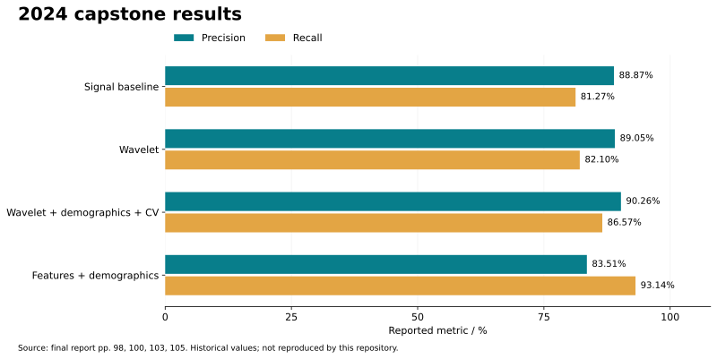

# Research case study

## Problem and design

The capstone investigated how wireless vital-sign monitoring could support patient mobility and make ECG analysis available through a monitoring interface. The system design joined sensor acquisition, wireless transport, cloud data handling, and classification. It combined AD8232 ECG sensing, MAX30100 pulse oximetry, MAX30205 temperature sensing, Arduino Mega, Digi XBee, and a Raspberry Pi base station.

The final report is the primary historical source: **G25_CSE491_FinalReport_S24.pdf**, dated May 2, 2024. The project poster and implementation submission provide supporting architecture context. These original documents are retained locally, rather than bundled with student IDs, administrative material, and interface examples in this public source tree.

## Three-lead classification

The report describes PTB-XL and Georgia recordings from PhysioNet 2020 at 500 Hz, padded or truncated to 5,000 samples. Age and sex were read from headers. It compared a signal-based SE-ResNet approach with a feature-based dense network (pp. 64–73).

| Label | Meaning | Reported label count |
| --- | --- | ---: |
| NSR | Normal sinus rhythm | 18,092 |
| AF | Atrial fibrillation | 1,514 |
| STach | Sinus tachycardia | 826 |
| SA | Sinus arrhythmia | 772 |
| SB | Sinus bradycardia | 637 |
| PAC | Premature atrial contraction | 398 |
| SVPB | Supraventricular premature beats | 157 |
| AFL | Atrial flutter | 73 |
| SVT | Supraventricular tachycardia | 27 |

Counts are transcribed from report Table 4, p. 66. Labels can co-occur, so their sum is not a count of unique patients or recordings.

## Reported experiments

| Historical experiment | Precision | Recall | Reported accuracy | Report page |
| --- | ---: | ---: | ---: | ---: |
| Baseline signal model | 88.87% | 81.27% | 84.63% | 98 |
| With wavelet transformation | 89.05% | 82.10% | 88.06% | 100 |
| Wavelet + demographics + five-fold validation | 90.26% | 86.57% | Not reported | 102–103 |
| Features + demographics | 83.51% | 93.14% | 92.01% | 105 |

The last experiment trades lower precision for higher recall. Higher recall does not establish fewer false alarms: recall measures missed positive cases, whereas false alarms require separate false-positive analysis. No clinical benefit or reduction in alarm fatigue has been demonstrated by these aggregate figures.

The recovered code does not establish the exact averaging conventions, decision thresholds, split IDs, or checkpoint-to-result mapping for these experiments. Some prose interpretations of the confusion matrices in the report are inconsistent with the stated class counts. Accordingly, the table preserves the printed aggregate metrics without deriving new per-class claims or claiming a controlled ablation study. Raw transcribed values and page references are in [reported_results.json](reported_results.json).

## Wireless measurements

Report Table 7, p. 91, records 1,000 timestamped packets for each receiver networking protocol:

| Receiver uplink | Mean latency | Maximum latency |
| --- | ---: | ---: |
| Ethernet | 57 ms | 92 ms |
| Wi-Fi | 85 ms | 96 ms |

These are historical system-transport measurements, not ECG inference latency or a present-day performance guarantee. No hardware retest was performed during the code cleanup.

## What can be reproduced here

The maintained pipeline implements named-lead loading, physical-unit calibration, resampling, wavelet denoising, fixed-schema features, and a group-held-out random-forest baseline. An optional LSTM adapts the earlier recovered recurrent prototype. Synthetic fixtures exercise the pipeline and intentionally include labels absent from training to test edge cases.

The final SE-ResNet and feature-based neural network training code, original folds, and attributable checkpoints have not been recovered. Neither the maintained baseline nor the LSTM adaptation reproduces the table above. The original application and ZigBee integration are documented components, rather than executable components of this checkout.

## Research limitations

- Rare-label support is small and highly imbalanced; aggregate metrics can mask poor performance.
- The maintained feature extractor uses heuristic peak detection. Its RR-derived values are exploratory, not validated physiological measurements.
- Short recordings are zero-padded; long recordings retain the first ten seconds. Padding and event truncation can affect features and predictions.
- Group isolation depends on a correct patient mapping. A unique recording ID does not establish patient independence.
- Thresholds are fixed at 0.5. No external validation, calibration study, or threshold optimization is supplied.
- The LSTM currently uses unweighted binary cross-entropy. It is an engineering baseline, not a replication of the report's weighted-loss training.

## References

- [PhysioNet 2020 Challenge dataset](https://physionet.org/content/challenge-2020/1.0.2/) — recording format and source data.
- [PhysioNet Challenge paper](https://physionet.org/files/challenge-2020/1.0.1/papers/2020ChallengePaper.pdf) — diagnosis codes and label definitions.
- Le et al., [LightX3ECG](https://doi.org/10.1016/j.bspc.2023.104963), 2023 — cited as the signal-model reference in the original report, reference 42.
